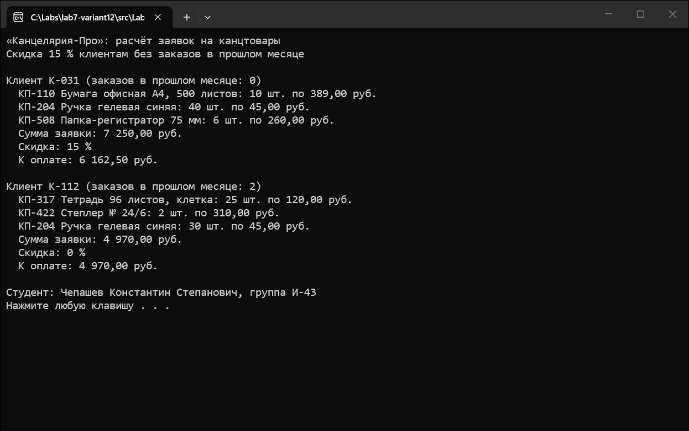
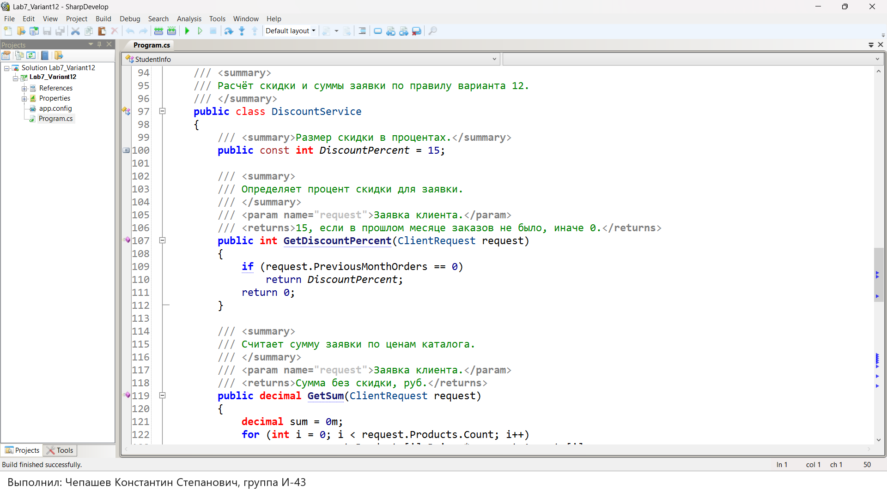
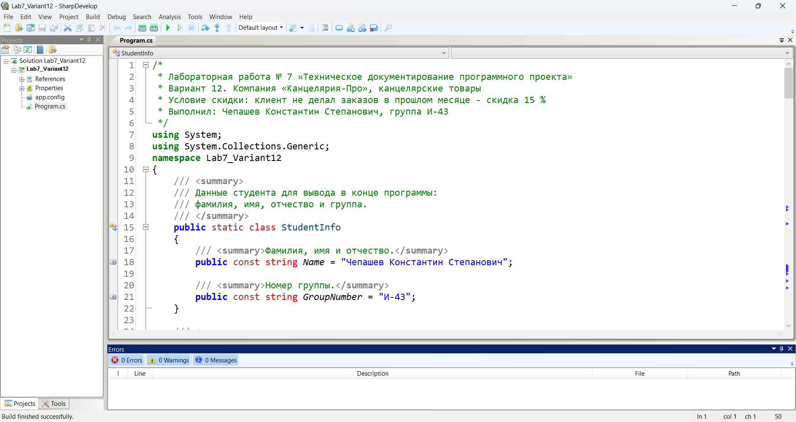
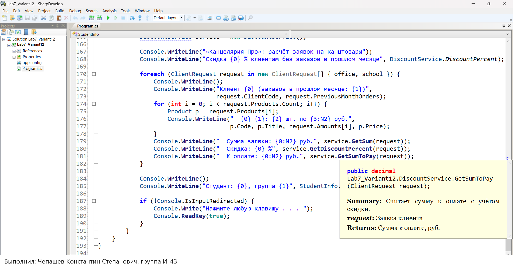

# Система заказов компании «Канцелярия-Про»

**Автор:** Чепашев Константин Степанович, группа И-43

**Репозиторий:** https://github.com/CrownCaptainMelt/lab7-variant12

Вариант 12. Консольная программа на C# считает стоимость заявок на канцелярские товары.

## Что делает программа

- описывает товары каталога: артикул, наименование и цену за штуку;
- принимает заявки клиентов с количеством каждого товара;
- по числу заказов клиента в прошлом месяце определяет скидку: 15 %, если заказов не было, иначе 0 %;
- печатает по каждой заявке сумму, процент скидки и сумму к оплате;
- в конце выводит фамилию и группу студента.

## Как запустить

1. Открыть файл `src/Lab7_Variant12.sln` в SharpDevelop 5.1 или Visual Studio.
2. Нажать F5 (меню Debug → Run).
3. Результат появится в окне консоли, для выхода нажать любую клавишу.

Требуется .NET Framework 4.8, он входит в состав Windows 10 и 11.

## Как устроен код

- `StudentInfo` - фамилия и группа студента, две константы в начале `Program.cs`;
- `Product` - товар каталога;
- `ClientRequest` - заявка клиента со списком товаров;
- `DiscountService` - расчёт скидки и сумм по правилу варианта;
- `Program.Main` - пример двух заявок и вывод результата.

Все открытые классы и методы снабжены XML-комментариями `
`, `<param>` и `<returns>`. При сборке файл документации `Lab7_Variant12.xml` создаётся рядом с программой.

## Скриншоты

### Скриншот 1: Результат работы программы

### Скриншот 2: XML-комментарии в коде

### Скриншот 3: Среда разработки

### Скриншот 4: Подсказка с текстом XML-комментария

